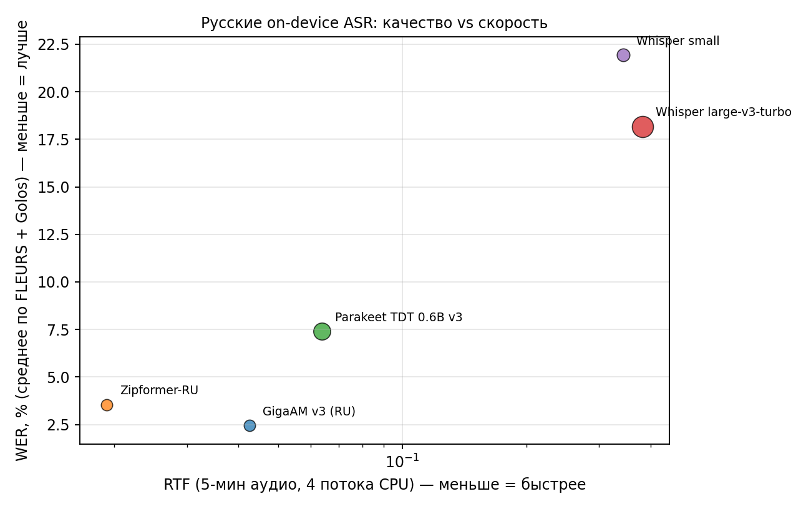
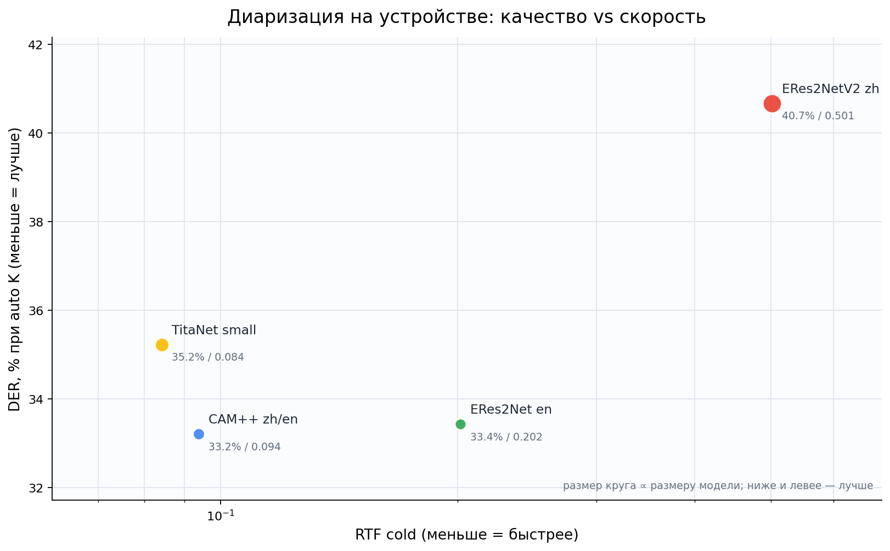

# On-device речь для Android: транскрипция + диаризация

Два локальных пайплайна для Android/Kotlin, без облака и без GPU:

- [`transcription/`](transcription/) — русский ASR: текст и тайминги слов,
  пунктуация и регистр от локальной LLM.
- [`diarization/`](diarization/) — «кто когда говорил»: 12 speaker-embedding
  моделей, автоопределение числа спикеров, назначение спикера каждому слову.

Вместе они дают расшифровку встречи с репликами:

```json
{"transcript":[
  {"speaker_id":1,"start_ms":1250,"end_ms":4380,"text":"Добрый день!"},
  {"speaker_id":2,"start_ms":4500,"end_ms":6000,"text":"Привет."}
]}
```

## Архитектура решения

```
┌──────────────┐   ┌────────────────────┐   ┌──────────────────────┐
│ file / Uri / │──▶│ AudioDecoder        │──▶│ Transcriber (ASR)     │
│ FloatArray   │   │ 16 кГц, моно, PCM   │   │ текст + слова + время │
└──────────────┘   └────────────────────┘   └──────────┬───────────┘
                                                       │ words
                                                       ▼
┌──────────────────────┐   ┌────────────────────┐   ┌──────────────────────┐
│ UtteranceBuilder     │◀──│ WordSpeakerAssigner │◀──│ Diarizer             │
│ склейка реплик       │   │ спикер на слово     │   │ сегменты «кто когда» │
└──────────┬───────────┘   └────────────────────┘   └──────────┬───────────┘
           │                                                   │
           ▼                                                   │
┌──────────────────────┐   ┌────────────────────┐              │
│ LocalLlm             │──▶│ DiarizedTranscript  │◀─────────────┘
│ пунктуация/правка    │   │ toJson()            │
└──────────────────────┘   └────────────────────┘
```

| Слой | Что делает | Где |
|---|---|---|
| `AudioDecoder` | WAV/MP3/MP4/M4A → 16 кГц моно PCM | `transcription/kotlin/transcribers/` |
| `Transcriber` | GigaAM / Zipformer / Whisper / Parakeet → текст + `WordTimestamp` | `transcription/kotlin/transcribers/` |
| `Diarizer` | pyannote segmentation + speaker embedding + кластеризация → сегменты | `diarization/kotlin/diarizers/` |
| `WordSpeakerAssigner` | слову — спикер по перекрытию/ближайшему сегменту | `diarization/kotlin/diarizers/` |
| `UtteranceBuilder` | слова → реплики с `speaker_id`, `start_ms`, `end_ms` | `diarization/kotlin/diarizers/` |
| `LocalLlm` | правка каждой реплики локальной LLM (пунктуация, регистр) | `transcription/kotlin/transcribers/` |
| `DiarizedTranscriber` | сквозной оркестратор, отдаёт точный JSON | `diarization/kotlin/diarizers/` |

Ключевое решение: **диаризация не переписывает ASR**. Сначала работает
готовый `Transcriber`, затем его словам приписываются спикеры. Поэтому можно
менять ASR и диаризатор независимо.

## Навигация

| Что | Где |
|---|---|
| **ASR-лидерборд:** WER, RTF, RAM, методика | [`transcription/leaderboard.md`](transcription/leaderboard.md) |
| **ASR Kotlin-классы:** `transcribe()` → текст + слова | [`transcription/kotlin/transcribers/`](transcription/kotlin/transcribers/) |
| **Диаризация-лидерборд:** DER, K exact/MAE, RTF, методика | [`diarization/leaderboard.md`](diarization/leaderboard.md) |
| **Диаризация Kotlin-классы:** `Diarizer`, 12 моделей, auto-K | [`diarization/kotlin/diarizers/`](diarization/kotlin/diarizers/) |
| **Сквозной класс:** файл → ASR → спикеры → JSON | [`DiarizedTranscriber.kt`](diarization/kotlin/diarizers/DiarizedTranscriber.kt) |
| Подключение sherpa-onnx и jniLibs | [`transcription/kotlin/README.md`](transcription/kotlin/README.md) |
| Как воспроизвести замеры | [`transcription/README.md`](transcription/README.md), [`diarization/README.md`](diarization/README.md) |
| **Протокол оценки:** датасеты, формулы, воспроизведение | [`docs/PROTOCOL.md`](docs/PROTOCOL.md) |
| **Ограничения решения** | [`docs/LIMITATIONS.md`](docs/LIMITATIONS.md) |
| **Результаты тестов** | [`docs/TEST_RESULTS.md`](docs/TEST_RESULTS.md) |
| Презентация защиты | [`docs/hackathon_defense.pptx`](docs/hackathon_defense.pptx) |

## Выбор моделей

### ASR

| Сценарий | Модель | Почему |
|---|---|---|
| Русская речь, максимум качества | **GigaAM v3** (229 МБ) | WER 2.44% на FLEURS+Golos |
| Слабое устройство / быстрая диктовка | **Zipformer-RU** (73 МБ) | RTF 0.019, приемлемый WER |
| Нужен английский/мультиязычность | Parakeet TDT 0.6B v3 | сильный multilingual, но 670 МБ |
| Whisper-совместимость | Whisper turbo/small | не рекомендуется через sherpa-onnx: зацикливается без fallback |

### Диаризация

| Сценарий | Модель | Почему |
|---|---|---|
| Android по умолчанию | **CAM++ zh/en** (~28 МБ) | лучшее соотношение DER/RTF/размер |
| Максимум качества на встрече | **ERes2Net en** / **TitaNet small** | лучший oracle DER / самый быстрый |
| Минимальный APK | **ERes2Net en** / **WeSpeaker ResNet34** | ~25 МБ |
| Русская речь | CAM++ zh/en или ERes2NetV2 | проверено на RU synthetic и Dialogs |

Автоопределение числа спикеров включено, но на коротких записях ошибается.
В UI нужен ручной override `numClusters`; для on-device используйте перебор
порогов (`estimateSpeakerCount = true`), в offline-бенчмарке — gap-статистику.

## Результаты коротко

### Транскрипция

| # | Модель | Размер | WER чтение | WER команды | WER avg | RTF | RAM |
|---|---|---|---|---|---|---|---|
| 1 | **GigaAM v3** | 229 МБ | 3.77% | 1.10% | **2.44%** | 0.043 | 337 МБ |
| 2 | **Zipformer-RU** | 73 МБ | 5.59% | 1.50% | 3.55% | **0.019** | 401 МБ |
| 3 | Parakeet TDT 0.6B v3 | 670 МБ | 7.69% | 7.09% | 7.39% | 0.064 | 988 МБ |
| 4 | Whisper large-v3-turbo | 1037 МБ | 13.89% | 22.48% | 18.18% | 0.382 | 2288 МБ |
| 5 | Whisper small | 375 МБ | 11.29% | 32.57% | 21.93% | 0.343 | 1234 МБ |

WER — доля ошибок в словах; подробный разбор — в
[`transcription/leaderboard.md`](transcription/leaderboard.md).



### Диаризация


| # | Модель | DER auto, % | DER oracle, % | K exact, % | RTF | Размер |
|---:|---|---:|---:|---:|---:|---:|
| 1 | **CAM++ zh/en** | **33.20** | 27.69 | 50.0 | 0.094 | 28 МБ |
| 2 | ERes2Net en | 33.43 | **27.28** | 50.0 | 0.202 | 26 МБ |
| 3 | TitaNet small | 35.22 | 29.61 | 50.0 | **0.084** | 40 МБ |
| 4 | ERes2NetV2 zh | 40.67 | 35.24 | 50.0 | 0.501 | 71 МБ |

DER — среднее по AMI test / Vox test / RU test (1 + 1 + 8 файлов). Полный
русский диалоговый тест: 5 диалогов, DER **18.97%**, word accuracy **88.11%**,
K exact 5/5. Подробности — в [`diarization/README.md`](diarization/README.md).



**Вывод:** CAM++ zh/en — дефолт для Android; ERes2Net en — если важнее
oracle-качество; TitaNet small — самый быстрый.

Подробные таблицы по датасетам, режимам и словам — в
[`diarization/leaderboard.md`](diarization/leaderboard.md).

## Android-приложение

В репозитории есть готовое приложение `android/`: Jetpack Compose, Room,
локальные GigaAM v3 и диаризация, запись и импорт аудио, редактор транскрипта.
Оно не требует облака после загрузки модели.

```bash
cd android
./gradlew assembleDebug        # APK: app/build/outputs/apk/debug/app-debug.apk
./gradlew installDebug         # на подключённое устройство
./gradlew testDebugUnitTest    # 63 JVM-теста без эмулятора
```

Подробная инструкция по сборке, установке модели и экранам —
[`android/README.md`](android/README.md); устройство кода и слои —
[`docs/ARCHITECTURE.md`](docs/ARCHITECTURE.md).

## Быстрый старт

Только транскрипция:

```kotlin
val asr: Transcriber = GigaAmTranscriber(
    context = applicationContext,
    modelDir = File(filesDir, "models/gigaam-v3"),
)
val result = asr.transcribe(File("/sdcard/record.mp4")) // WAV / MP3 / MP4
println(result.text)
```

Транскрипция + спикеры + JSON:

```kotlin
val transcriber = DiarizedTranscriber(
    context = applicationContext,
    transcriber = GigaAmTranscriber(applicationContext, File(filesDir, "models/gigaam-v3")),
    diarizer = CamPlusZhEnDiarizer(
        embeddingModel = File(modelsDir, CamPlusZhEnDiarizer.MODEL_FILE),
        segmentationModel = File(segDir, "model.int8.onnx"),
        estimateSpeakerCount = true,
    ),
    llm = LlamaCppLocalLlm.load(File(filesDir, "models/llm/qwen2.5-1.5b-instruct-q4_k_m.gguf")), // локальная LLM
)
val json = transcriber.use { it.transcribeToJson(File("/sdcard/meeting.mp3")) }
```

## Структура проекта

```
.
├── README.md                     # этот файл: архитектура, выбор моделей, установка
├── artifacts/                    # APK, презентация, видео
├── config/                       # модели и переменные окружения
├── docs/                         # архитектура, PPTX, генератор презентации
├── src/                          # карта исходников
├── android/                      # готовое Android-приложение (Compose + Room)
├── transcription/
│   ├── README.md                 # как воспроизвести ASR-замеры
│   ├── leaderboard.md            # WER, RTF, RAM, методика
│   ├── kotlin/
│   │   ├── README.md             # sherpa-onnx, jniLibs, VAD, грабли
│   │   └── transcribers/         # 5 ASR-классов + общий интерфейс
│   ├── scripts/                  # download/eval/speed/report
│   └── results/                  # сырые метрики
└── diarization/
    ├── README.md                 # методика, auto-K, Kotlin API
    ├── leaderboard.md            # DER, K exact/MAE, word accuracy
    ├── kotlin/diarizers/         # Diarizer, 12 моделей, сквозной класс
    ├── scripts/                  # benchmark/evaluate/word_assignment/report
    └── results/                  # leaderboard.*, raw/*.jsonl, transcripts/
```

### Как в шаблоне хакатона

| Папка | Что сдаём |
|---|---|
| [`artifacts/`](artifacts/) | APK, презентация (PPTX и PDF) и видео |
| [`config/`](config/) | модели, лицензии, переменные окружения |
| [`docs/`](docs/) | архитектура, PPTX, генератор презентации |
| [`src/`](src/) | карта исходников Android + research |
| [`android/`](android/) | исходники приложения |
| [`transcription/`](transcription/), [`diarization/`](diarization/) | research-код и лидерборды |

Модели и датасеты не коммитятся: это несколько ГБ, они скачиваются скриптами.

## Ограничения

- ASR-бенчмарк — FLEURS (чтение) и Golos (короткие команды); длинные
  спонтанные лекции будут сложнее.
- Диаризация проверена на AMI, VoxConverse и **синтетическом** русском
  датасете; живую русскую речь с перекрытиями нужно проверять отдельно.
- Автоопределение числа спикеров не идеально: записи короче ~40 с и
  многоголосые перекрытия — зона риска.
- Whisper через sherpa-onnx не рекомендуется: greedy-декодер без fallback
  зацикливается на части фраз.
- Все замеры — CPU (AMD Ryzen 5 5500), без GPU; на телефоне абсолютные RTF
  будут другими.

---

## Установка

### 1. Требования

- Android Studio (Kotlin), `minSdk 24+`, `arm64-v8a` (для эмулятора — `x86_64`).
- [sherpa-onnx](https://github.com/k2-fsa/sherpa-onnx/releases) Android
  runtime: `libsherpa-onnx-jni.so`, `libonnxruntime.so` и Kotlin API.
- Python 3.11 — только для offline-бенчмарков, на устройстве не нужен.
- Свободное место: ~1 ГБ под модели ASR + ~150 МБ под диаризацию.

### 2. Подключить sherpa-onnx

Скачайте Android-архив нужной версии и распакуйте:

```bash
wget https://github.com/k2-fsa/sherpa-onnx/releases/download/v2.0.1/sherpa-onnx-v2.0.1-android.tar.bz2
tar xf sherpa-onnx-v2.0.1-android.tar.bz2
```

Скопируйте в проект:

```
app/src/main/jniLibs/arm64-v8a/libonnxruntime.so
app/src/main/jniLibs/arm64-v8a/libsherpa-onnx-jni.so
app/src/main/java/com/k2fsa/sherpa/onnx/*.kt   # Kotlin API из архива
```

`app/build.gradle.kts`:

```kotlin
android {
    defaultConfig {
        ndk { abiFilters += listOf("arm64-v8a") } // + "x86_64" для эмулятора
    }
    packaging { jniLibs { useLegacyPackaging = false } }
    androidResources { noCompress += listOf("onnx") }
}
```

> Не обфусцируйте `com.k2fsa.sherpa.onnx`: JNI ищет классы и методы по именам.

### 3. Скопировать Kotlin-классы

```
transcription/kotlin/transcribers/*.kt  → app/src/main/java/com/nuclearhack/transcription/
diarization/kotlin/diarizers/*.kt       → app/src/main/java/com/nuclearhack/diarization/
```

Пакеты уже соответствуют этим каталогам. Для сквозного класса нужны обе
группы: `DiarizedTranscriber` импортирует `Transcriber`, `AudioDecoder` и
`LocalLlm` из `com.nuclearhack.transcription`.

### 4. Скачать и положить модели

ASR (пример для GigaAM v3):

```bash
cd transcription
python scripts/download.py
python scripts/download_parakeet.py          # опционально
python scripts/download_llm.py --model qwen2.5-1.5b   # локальная LLM, пунктуация
```

Диаризация:

```bash
cd diarization
python scripts/download.py                   # 12 embedding-моделей + сегментатор
```

На устройстве удобно хранить модели в `context.filesDir/models/` и докачивать
при первом запуске (GigaAM 229 МБ не влезет в базовый APK Play Store).
Итоговая раскладка:

```
filesDir/models/
├── gigaam-v3/                    # encoder.int8.onnx, decoder.onnx, joiner.onnx, tokens.txt
├── llm/
│   └── qwen2.5-1.5b-instruct-q4_k_m.gguf
└── diarization/
    ├── sherpa-onnx-pyannote-segmentation-3-0/model.int8.onnx
    └── 3dspeaker_speech_campplus_sv_zh_en_16k-common_advanced.onnx
```

Локальная LLM скачивается приложением автоматически при первом запуске
(~1.1 ГБ). Остальные модели — по кнопке «Скачать».

`assets` подходит только для небольших моделей; `.onnx` не сжимайте
(`noCompress`). Для больших файлов используйте `filesDir` или
`WorkManager`-докачку.

### 5. Инициализация в приложении

```kotlin
val modelsDir = File(filesDir, "models")
val segDir = File(modelsDir, "diarization/sherpa-onnx-pyannote-segmentation-3-0")

val transcriber = DiarizedTranscriber(
    context = applicationContext,
    transcriber = GigaAmTranscriber(
        context = applicationContext,
        modelDir = File(modelsDir, "gigaam-v3"),
        numThreads = 4,
    ),
    diarizer = CamPlusZhEnDiarizer(
        embeddingModel = File(modelsDir, "diarization/3dspeaker_speech_campplus_sv_zh_en_16k-common_advanced.onnx"),
        segmentationModel = File(segDir, "model.int8.onnx"),
        numThreads = 2,
        estimateSpeakerCount = true,
    ),
    llm = null, // или LlamaCppLocalLlm.load(...)
)

val json = transcriber.use { it.transcribeToJson(file) }
```

Тяжёлые операции (`transcribe`, `diarize`) запускайте в фоновом потоке:
`Dispatchers.Default` или `Executors.newSingleThreadExecutor()`.

### 6. Проверка

JVM-тесты без Gradle:

```powershell
cd transcription/kotlin/transcribers
powershell -ExecutionPolicy Bypass -File run_unit_tests.ps1

cd ../../../diarization/kotlin/diarizers
powershell -ExecutionPolicy Bypass -File run_unit_tests.ps1
```

ASR: 71 unit-тест, диаризация: 25 unit-тестов. Instrumentation-тест декодера
лежит в `transcription/kotlin/transcribers/src/androidTest/` и требует
эмулятор/устройство.

### 7. Воспроизвести бенчмарки (опционально)

```bash
pip install sherpa-onnx onnxruntime soundfile numpy scipy scikit-learn \
    pyannote.core datasets jiwer num2words pyarrow psutil matplotlib

cd transcription
python scripts/download.py
python scripts/eval.py
python scripts/eval_golos.py
python scripts/speed.py
python scripts/make_report.py

cd ../diarization
python scripts/download.py
python scripts/download_data.py
python scripts/benchmark.py --stage screen --models all --modes oracle \
    --scales 2.0:1.0 --per-dataset 2 --ru-per-k 2
python scripts/benchmark.py --stage test \
    --models campplus_zh_en,eres2net_en,eres2netv2_zh,titanet_small \
    --modes auto,oracle,sherpa_auto,sherpa_oracle \
    --scales 3.0:1.5 --auto-k-scales 2.0:1.0 --per-dataset 1
python scripts/word_assignment.py --dataset ru_test --per-k 3 \
    --model campplus_zh_en --scales 2.0:1.0 --oracle-k
python scripts/report.py
```

### 8. Частые проблемы

| Симптом | Причина / решение |
|---|---|
| `UnsatisfiedLinkError` | не скопирован `libsherpa-onnx-jni.so` под нужный ABI |
| Модель не найдена | путь должен быть абсолютным (`File(...).absolutePath`) |
| Щелчки/мусор в тексте | аудио не 16 кГц; используйте `AudioDecoder` |
| OOM на Whisper | 1 ГБ весов; возьмите GigaAM или Zipformer |
| Авто-K даёт 1 спикера | короткая запись; задайте `numClusters` вручную |
| Долгая обработка | `numThreads=2..4`, не запускайте на UI-потоке |
