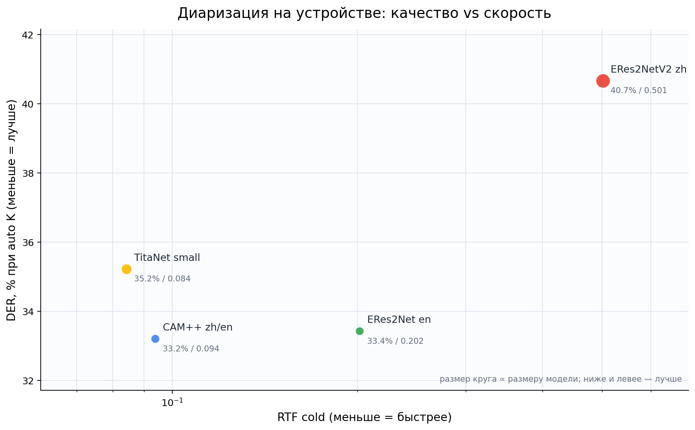

# Ветка `diarization` — диаризация на устройстве

Сравнение 12 speaker-embedding моделей для задачи «кто когда говорил» в одном
локальном пайплайне: pyannote segmentation 3.0 + оконные эмбеддинги +
кластеризация с автоматическим определением числа спикеров. Всё работает
**на устройстве**, без облака, на ONNX Runtime через
[sherpa-onnx](https://github.com/k2-fsa/sherpa-onnx), и запускается в
Android/Kotlin.

Поверх диаризации — сквозной класс `DiarizedTranscriber`: он берёт готовый
ASR-класс из [`transcription/`](../transcription/), приписывает каждому слову
спикера, склеивает слова в реплики и отдаёт ровно такой JSON:

```json
{"transcript":[
  {"speaker_id":1,"start_ms":1250,"end_ms":4380,"text":"Добрый день!"}
]}
```

## Навигация

| Что | Где |
|---|---|
| **Главный документ:** лидерборд, методика, метрики, сырые цифры | [`leaderboard.md`](leaderboard.md) |
| **Kotlin-классы:** общий `Diarizer`, 12 обёрток под модели, auto-K, назначение слов, склейка реплик | [`kotlin/diarizers/`](kotlin/diarizers/) |
| **Сквозной класс:** файл/URI/сэмплы → ASR → диаризация → JSON | [`kotlin/diarizers/DiarizedTranscriber.kt`](kotlin/diarizers/DiarizedTranscriber.kt) |
| **Тесты:** 25 JVM unit-тестов без Gradle | [`kotlin/diarizers/src/test/`](kotlin/diarizers/src/test/) |
| Скрипты бенчмарка и оценки | [`scripts/`](scripts/) |
| Сырые результаты: JSONL, CSV, JSON | [`results/`](results/) |
| Транскрипция и локальная LLM | [`../transcription/`](../transcription/) |

## Результат коротко


### Финальный test (кратко)

| # | Модель | DER auto, % | DER oracle, % | K exact, % | RTF | Размер |
|---:|---|---:|---:|---:|---:|---:|
| 1 | **CAM++ zh/en** | **33.20** | 27.69 | 50.0 | 0.094 | 28 МБ |
| 2 | ERes2Net en | 33.43 | **27.28** | 50.0 | 0.202 | 26 МБ |
| 3 | TitaNet small | 35.22 | 29.61 | 50.0 | **0.084** | 40 МБ |
| 4 | ERes2NetV2 zh | 40.67 | 35.24 | 50.0 | 0.501 | 71 МБ |

DER — среднее по AMI test / Vox test / RU test. Подробные таблицы, включая
dev-скрининг на 12 моделях, — ниже и в [`leaderboard.md`](leaderboard.md).



Ниже и левее — лучше. Размер круга пропорционален размеру модели.

**Вывод:** для Android по умолчанию — **3D-Speaker CAM++ zh/en**: около 28 МБ,
Apache-2.0, лучшее соотношение качества и скорости (DER auto 33.20%, RTF 0.094).
Если важнее качество на встрече и есть запас CPU — **ERes2Net en** (лучший
oracle DER, 27.28%) или **TitaNet small** (самый быстрый, RTF 0.084).
Автоматическое число спикеров работает, но ошибается на коротких записях,
поэтому в UI нужна возможность задать K вручную.

## Быстрый старт в Kotlin

```kotlin
val diarizer = CamPlusZhEnDiarizer(
    embeddingModel = File(modelsDir, CamPlusZhEnDiarizer.MODEL_FILE),
    segmentationModel = File(segDir, "model.int8.onnx"),
    numThreads = 2,
    estimateSpeakerCount = true, // авто-K перебором порогов
)

val result = diarizer.diarize(samples, sampleRate = 16_000)
result.segments.forEach { s ->
    println("${s.start}..${s.end} — speaker ${s.speaker}")
}
result.speakerLabels().forEach { (cluster, label) ->
    println("$cluster -> $label")
}
diarizer.close()
```

Сегменты — в секундах, `speaker` — номер кластера. ID `1`, `2` стабильны: первый по времени спикер всегда получает `speaker_id = 1`.

### Сквозной JSON

```kotlin
val transcriber = DiarizedTranscriber(
    context = applicationContext,
    transcriber = GigaAmTranscriber(
        context = applicationContext,
        modelDir = File(filesDir, "models/gigaam-v3"),
    ),
    diarizer = CamPlusZhEnDiarizer(
        embeddingModel = File(modelsDir, CamPlusZhEnDiarizer.MODEL_FILE),
        segmentationModel = File(segDir, "model.int8.onnx"),
        estimateSpeakerCount = true,
    ),
    llm = LlamaCppLocalLlm.load(File(filesDir, "models/qwen2.5-1.5b-instruct-q4_k_m.gguf")),
)

val json = transcriber.use {
    it.transcribeToJson(File("/sdcard/meeting.mp3"))
}
println(json)
// {"transcript":[
//   {"speaker_id":1,"start_ms":1250,"end_ms":4380,"text":"Добрый день!"},
//   {"speaker_id":2,"start_ms":4500,"end_ms":6000,"text":"Привет."}
// ]}
```

`DiarizedTranscriber` ничего не переизобретает: ASR — из `transcription`,
диаризация — из `Diarizer`, назначение слов — `WordSpeakerAssigner`, склейка —
`UtteranceBuilder`, правка текста — `LocalLlm`. Если LLM нет или она вернула
пустой ответ, остаётся сырой текст ASR.

## Архитектура диаризации

```
audio 16 кГц моно
        │
        ▼
pyannote segmentation 3.0 (int8, 10-секундные окна)
        │  labels[N, 589, 3] — локальные спикеры по кадрам
        ▼
build_window_units: чистые окна речи (purity ≥ 0.7, речь ≥ 50 %)
        │  2 с/1 с  и/или  3 с/1.5 с
        ▼
speaker embedding (12 ONNX-моделей) → L2-нормированный вектор на окно
        │  X[N, D]
        ▼
Complete-linkage AHC по косинусу
        │
        ├── oracle K: число спикеров известно
        └── auto K: gap-статистика на окнах 2 с/1 с
        │
        ▼
покадровое декодирование sherpa-onnx:
голосование окон → top-K спикеров на кадр → склейка пауз
        │
        ▼
сегменты {start, end, speaker}
        │
        ▼
WordSpeakerAssigner: слово → спикер по перекрытию / ближайшему сегменту
        │
        ▼
UtteranceBuilder: смена спикера / пауза > 1.2 с / длина > 15 с
        │
        ▼
{"transcript":[{"speaker_id":1,"start_ms":1250,"end_ms":4380,"text":"..."}]}
```

| Компонент | Что делает | Файл |
|---|---|---|
| `segment_waveform` | pyannote 3.0, 10-секундные окна, powerset 7 классов | `scripts/pipeline.py` |
| `build_window_units` | отбирает чистые окна речи нужного масштаба | `scripts/pipeline.py` |
| `embed_units` | считает эмбеддинг на окно выбранной моделью | `scripts/pipeline.py` |
| `auto_speaker_count` | gap-статистика + PCA-bounding-box эталон | `scripts/pipeline.py` |
| `decode_segments` | покадровое голосование и склейка пауз | `scripts/pipeline.py` |
| `evaluate_file` | DER с collar 0.25 с, UEM, trim RU | `scripts/evaluate.py` |
| `WordSpeakerAssigner` | спикер для каждого слова | Kotlin + `scripts/word_assignment.py` |
| `UtteranceBuilder` | склейка слов в реплики | `kotlin/diarizers/UtteranceBuilder.kt` |
| `DiarizedTranscriber` | сквозной оркестратор + JSON | `kotlin/diarizers/DiarizedTranscriber.kt` |

### Два варианта auto-K

| | Python-бенчмарк | Android/Kotlin |
|---|---|---|
| Метод | gap-статистика | перебор порогов 0.4–0.8 |
| Окна | 2 с/1 с для K, 3 с/1.5 с для кластеризации | внутри sherpa-onnx |
| Плюс | не требует ручного порога | работает на публичном Kotlin API |
| Минус | CPU-heavy, нужен экстрактор эмбеддингов | 5 полных прогонов на файл |

## Как это работает

1. **ASR с таймингами слов.** Любой `Transcriber` из `transcription`
   (GigaAM v3, Zipformer-RU, Whisper и т.д.) отдаёт `text` и `words` с
   `start`/`end`.
2. **Сегментация.** `sherpa-onnx-pyannote-segmentation-3-0` (int8, MIT)
   режет аудио на 10-секундные окна и предсказывает покадровых локальных
   спикеров (powerset, 7 классов).
3. **Оконные эмбеддинги.** Из сегментации берутся «чистые» окна речи без
   перекрытия: purity ≥ 0.7, речи ≥ 50 %. Для каждого окна выбранная
   embedding-модель считает L2-нормированный вектор. Окна — 2 с/1 с или
   3 с/1.5 с; масштаб задаётся в конфиге.
4. **Кластеризация.** Complete-linkage AHC по косинусу. Complete linkage
   важен: single/avg linkage на этих данных склеивает разных спикеров.
5. **Число спикеров.** Oracle K — если количество известно; иначе
   gap-статистика с PCA-bounding-box эталоном на окнах 2 с/1 с.
6. **Декодирование.** Покадровое голосование окон за локальных спикеров,
   top-K активных спикеров на кадр, склейка коротких пауз — как в
   `OfflineSpeakerDiarization`.
7. **Слова → спикеры.** Для каждого слова ASR выбирается спикер с
   максимальным перекрытием по времени; слово в паузе уходит к ближайшему
   сегменту. В Python дополнительно проверялся вариант с эмбеддингом слова,
   но на Android sherpa-onnx не отдаёт экстрактор эмбеддингов.
8. **Реплики.** Слова склеиваются, пока не сменился спикер, не прошла пауза
   больше `maxGapSeconds` и не превышена `maxUtteranceSeconds`. Опционально
   каждая реплика отдельно правится локальной LLM.

## Автоматическое число спикеров

### Python: gap-статистика

Для K = 1..12 считается внутрикластерный разброс после AHC. Он сравнивается
с эталонным распределением: те же точки проецируются в PCA-пространство и
равномерно разбрасываются внутри ограничивающего параллелепипеда; процедура
повторяется 10 раз. Выбирается минимальный K, где gap-кривая выходит на
плато с учётом стандартного отклонения. K=1 — валидный ответ для монолога.

Авто-K считается на окнах **2 с/1 с** (больше окон → устойчивее статистика),
а кластеризация — на окнах **3 с/1.5 с** (лучше эмбеддинги). Это разделение
задаётся `auto_k_scales` и не требует второго прохода сегментации.

### Kotlin: перебор порогов

В Kotlin API sherpa-onnx нет публичного экстрактора эмбеддингов, поэтому
вместо gap-статистики используется `SpeakerCountSweep`: несколько прогонов
`OfflineSpeakerDiarization` с порогами 0.4–0.8. При низком пороге модель
дробит спикеров, при высоком — склеивает. Настоящее K обычно образует
«плато» из соседних порогов; выбирается самое частое K, при равенстве —
ближайшее к медиане, внутри плато — ближе к середине диапазона. Та же логика
реализована в Python как `--modes sherpa_sweep`.

### Что важно знать

- На AMI авто-K часто даёт **K=3 вместо 4**; DER при этом страдает умеренно,
  потому что «потерянный» спикер говорит мало.
- На RU-синтетике с 4 спикерами авто-K иногда даёт **K=1–2**: короткие
  реплики и длинные паузы TTS сбивают статистику.
- На Vox с большим числом спикеров авто-K может занижать K, но DER меняется
  слабо, если редкие спикеры молчат большую часть файла.
- Записи короче ~40 с — зона риска. В продакшене давайте пользователю
  переопределить K.

Точность авто-K видна в колонках `K exact` и `K MAE` лидерборда.

## Датасеты

| Датасет | Что это | Файлы | Язык | Лицензия / источник |
|---|---|---:|---|---|
| AMI IHM, validation + test | реальные встречи, 4 спикера, headset-микрофоны, перекрытия | 6 + 10 | англ. | [AMI](https://groups.inf.ed.ac.uk/ami/corpus/), CC BY 4.0 |
| VoxConverse, dev + test | ролики in-the-wild, 1–20 спикеров, шум и музыка | 8 + 10 | англ. | [VoxConverse](https://github.com/joonson/voxconverse), CC BY 4.0 |
| `ivkond/synthetic-speech-diarization-ru`, dev + test | синтетика (TTS), 1–4 спикера, паузы и шум | 32 + 48 | рус. | [HF dataset](https://huggingface.co/datasets/ivkond/synthetic-speech-diarization-ru), MIT |

**RU-датасет синтетический.** Это TTS, а не живая речь. В нём длинные паузы
внутри реплик, поэтому DER считается по эталону, обрезанному по энергии:
тишина внутри реплик удаляется. Иначе метрика измеряет соглашение о паузах,
а не качество диаризации. Для AMI и Vox обрезка не применяется.

Файлы приводятся к 16 кГц моно; идентификаторы спикеров в эталоне не имеют
семантики и сопоставляются с гипотезой по перестановке (Hungarian) при
подсчёте word accuracy.

## Метрики: что именно считается

| Метрика | Формула / правило | Что показывает | Как читать |
|---|---|---|---|
| **DER** | `(confusion + miss + false_alarm) / ref_speech` | Доля времени эталонной речи, размеченная неверно | Меньше = лучше. 10% значит, что 10% речи спикеров размечено неправильно |
| **confusion** | время речи, где гипотеза назвала **не того** спикера / `ref_speech` | Спикер определён, но перепутан | Главная ошибка при хорошей сегментации |
| **miss** | время эталонной речи, которое система **не нашла** / `ref_speech` | Пропущенная речь | Растёт на тихой/далёкой речи |
| **false alarm** | время гипотезы там, где эталонной речи **нет** / `ref_speech` | Лишняя речь | Растёт на шуме, музыке, паузах |
| **collar 0.25 с** | ошибки в пределах ±250 мс от границы сегмента не штрафуются | Допуск на неточность границы | Стандарт для DER; без collar цифры хуже |
| **UEM** | весь файл, `0..duration` | Область оценки | Мы не выбрасываем паузы и края записи |
| **K exact** | `files_with_hyp_K == ref_K / files` | Доля файлов с точно угаданным числом спикеров | 100% = везде правильное K |
| **K MAE** | `mean(abs(hyp_K - ref_K))` | Средняя абсолютная ошибка K | 0.5 = в среднем ошибаемся на полспикера |
| **K bias** | `mean(hyp_K - ref_K)` | Систематическое завышение/занижение K | `+1` = стабильно добавляем лишнего спикера |
| **RTF** | `processing_seconds / audio_seconds` | Во сколько раз быстрее/медленнее реального времени | `0.1` = 10 минут аудио за 1 минуту; `<1` — быстрее realtime |
| **Word accuracy** | `correct_words / evaluated_words` | Доля слов, которым приписан правильный спикер | Считается после ASR; спикеры сопоставляются Hungarian-перестановкой |
| **Word coverage** | `covered_words / all_words` | Доля слов, где эталонный спикер покрывает ≥50% длительности слова | Слова на стыке реплик не входят в accuracy |
| **Speaker count exact** | то же, что K exact, но по файлам | Точность автоопределения K | Видно, где ломается auto-K |

### Пример чтения

Если в файле 100 секунд эталонной речи, из них 8 секунд приписаны не тому
спикеру, 2 секунды пропущены и 3 секунды найдены на шуме, то
`DER = (8 + 2 + 3) / 100 = 13%`, `confusion = 8%`, `miss = 2%`,
`false alarm = 3%`.

Для word accuracy: если из 100 слов у 90 эталонный спикер покрывает больше
половины слова и 81 из них получил правильного спикера, accuracy = 90%,
coverage = 90%. Слова, где эталонный спикер не покрывает половину, не
штрафуются — иначе стыки реплик и паузы искажали бы метрику.

## Лидерборд


### Скрининг (dev, oracle K)

Одинаковый режим для всех 12 моделей: окна 2 с/1 с, complete linkage,
oracle K. DER — среднее по AMI validation / Vox dev / RU dev.

| # | Модель | DER, % | confusion, % | miss, % | false alarm, % | K exact, % | K MAE | RTF | Размер, МБ |
|---:|---|---:|---:|---:|---:|---:|---:|---:|---:|
| 1 | `titanet_small` | 14.38 | 5.69 | 1.32 | 3.55 | 91.7 | 0.08 | 0.018 | 40.3 |
| 2 | `campplus_zh_en` | 15.32 | 6.80 | 1.25 | 3.59 | 100.0 | 0.00 | 0.025 | 28.3 |
| 3 | `eres2netv2_zh` | 15.93 | 7.13 | 1.27 | 3.52 | 100.0 | 0.00 | 0.109 | 71.4 |
| 4 | `titanet_large` | 16.60 | 7.75 | 1.31 | 3.45 | 100.0 | 0.00 | 0.055 | 101.4 |
| 5 | `campplus_en` | 17.28 | 8.27 | 1.32 | 3.61 | 100.0 | 0.00 | 0.024 | 29.6 |
| 6 | `eres2net_en` | 17.32 | 8.93 | 1.29 | 3.71 | 100.0 | 0.00 | 0.047 | 26.5 |
| 7 | `eres2net_base_zh` | 20.08 | 11.58 | 1.27 | 3.57 | 91.7 | 0.08 | 0.047 | 39.6 |
| 8 | `wespeaker_resnet34` | 24.06 | 17.05 | 1.27 | 3.54 | 100.0 | 0.00 | 0.042 | 26.5 |
| 9 | `wespeaker_campplus` | 31.45 | 23.06 | 1.29 | 3.83 | 100.0 | 0.00 | 0.030 | 29.3 |
| 10 | `wespeaker_resnet293` | 32.36 | 27.86 | 1.60 | 3.60 | 100.0 | 0.00 | 0.266 | 114.3 |
| 11 | `wespeaker_resnet221` | 33.91 | 26.07 | 1.24 | 3.81 | 100.0 | 0.00 | 0.205 | 95.0 |
| 12 | `wespeaker_resnet152` | 35.65 | 32.31 | 1.28 | 3.70 | 100.0 | 0.00 | 0.139 | 79.2 |


### Финальный test (held-out)

4 модели на 1 файле AMI test, 1 файле VoxConverse test и 8 файлах RU test.
Окна: 3 с для AMI/Vox, 2 с для RU; RTF — cold-start без кэша.

#### Авто K

| # | Модель | DER, % | confusion, % | miss, % | false alarm, % | K exact, % | K MAE | RTF | Размер, МБ |
|---:|---|---:|---:|---:|---:|---:|---:|---:|---:|
| 1 | `campplus_zh_en` | 33.20 | 12.97 | 16.29 | 3.70 | 50.0 | 0.80 | 0.094 | 28.3 |
| 2 | `eres2net_en` | 33.43 | 13.23 | 16.37 | 3.67 | 50.0 | 0.80 | 0.202 | 26.5 |
| 3 | `titanet_small` | 35.22 | 14.98 | 16.39 | 3.63 | 50.0 | 0.80 | 0.084 | 40.3 |
| 4 | `eres2netv2_zh` | 40.67 | 15.39 | 21.83 | 2.84 | 50.0 | 1.00 | 0.501 | 71.4 |

#### Oracle K

| # | Модель | DER, % | confusion, % | miss, % | false alarm, % | K exact, % | K MAE | RTF | Размер, МБ |
|---:|---|---:|---:|---:|---:|---:|---:|---:|---:|
| 1 | `eres2net_en` | 27.28 | 6.33 | 16.41 | 4.53 | 100.0 | 0.00 | 0.202 | 26.5 |
| 2 | `campplus_zh_en` | 27.69 | 6.62 | 16.30 | 4.71 | 100.0 | 0.00 | 0.094 | 28.3 |
| 3 | `titanet_small` | 29.61 | 8.36 | 16.44 | 4.65 | 100.0 | 0.00 | 0.084 | 40.3 |
| 4 | `eres2netv2_zh` | 35.24 | 14.24 | 16.40 | 4.53 | 100.0 | 0.00 | 0.501 | 71.4 |

#### Baseline: старый sherpa threshold

| Режим | Модель | DER, % | K exact, % | K MAE |
|---|---|---:|---:|---:|
| авто, threshold 0.5 | `eres2netv2_zh` | 34.92 | 20.0 | 2.10 |
| авто, threshold 0.5 | `campplus_zh_en` | 43.82 | 30.0 | 3.00 |
| oracle K | `eres2net_en` | 27.10 | 90.0 | 0.10 |
| oracle K | `campplus_zh_en` | 27.44 | 90.0 | 0.10 |

Порог 0.5 на AMI/Vox дробит спикеров (K=8–22), поэтому DER резко растёт.
Это тот baseline, который заменён на AHC + auto-K.

### Полный пайплайн на русском диалоговом корпусе

Корпус `langswap/dialogs-ru-emotional-conversations` (Interspeech 2026,
OpenRAIL): реальная студийная русская диалоговая речь, 3 актёра. Из test-сплита
собраны 5 диалогов по 2 спикера (реплики склеены с паузами 0.45 с, суммарно
~8.3 мин). Полный пайплайн: GigaAM v3 → CAM++ zh/en → назначение слов →
склейка реплик → JSON.

| Режим | Файлов | DER, % | Word accuracy, % | K exact, % |
|---|---:|---:|---:|---:|
| авто K | 5 | **18.97** | **88.11** | 100 |
| oracle K | 5 | 18.97 | 88.11 | 100 |

Все 5 диалогов получили K=2/2. Примеры JSON:
[`results/transcripts/`](results/transcripts/). Один из диалогов даёт DER 46.1%
(перекрытия и короткие реплики), остальные — 5–21%; это честный разброс,
а не только средняя.

### Назначение спикеров словам (RU test)

| Режим | Слов | Overlap accuracy | Embedding accuracy |
|---|---:|---:|---:|
| авто K | 484 | 82.82% | 83.64% |
| oracle K | 484 | 90.27% | 91.10% |

Coverage — 100%: каждому слову, у которого эталонный спикер покрывает ≥ 50%
длительности, спикер назначен. Embedding-вариант чуть лучше на стыках реплик.

### Kotlin auto-K (sherpa sweep)

| Датасет | Файлов | DER, % | K exact, % | K MAE |
|---|---:|---:|---:|---:|
| RU dev | 8 | 27.85 | 75.0 | 0.38 |
| RU test | 8 | 42.52 | 75.0 | 0.38 |
| AMI test | 1 | 48.48 | 0.0 | 14.00 |
| Vox test | 1 | 8.26 | 0.0 | 1.00 |

На русских коротких диалогах пороговый sweep работает хорошо (75% точного K),
на длинном AMI — плохо: пороги не образуют устойчивого плато, и выбор уходит
в перекластеризацию. Это ограничение метода, а не реализации.

Подробные таблицы по каждому датасету, режиму и слову — в
[`leaderboard.md`](leaderboard.md).

## Kotlin API

### Модели

Все классы — тонкие обёртки над `SherpaDiarizer`; отличается только файл
эмбеддингов. Переключение модели — одна строка.

| Модель | Класс | Размер | Размерность | Лицензия |
|---|---|---:|---:|---|
| `campplus_zh_en` | `CamPlusZhEnDiarizer` | ~27 МБ | 192 | Apache-2.0 |
| `campplus_en` | `CamPlusEnDiarizer` | ~28 МБ | 512 | Apache-2.0 |
| `eres2netv2_zh` | `ERes2NetV2ZhDiarizer` | ~68 МБ | 192 | Apache-2.0 |
| `eres2net_base_zh` | `ERes2NetBaseZhDiarizer` | ~38 МБ | 512 | Apache-2.0 |
| `eres2net_en` | `ERes2NetEnDiarizer` | ~25 МБ | 192 | Apache-2.0 |
| `titanet_small` | `TitaNetSmallDiarizer` | ~38 МБ | 192 | NVIDIA NeMo |
| `titanet_large` | `TitaNetLargeDiarizer` | ~97 МБ | 192 | NVIDIA NeMo |
| `wespeaker_campplus` | `WeSpeakerCamPlusDiarizer` | ~28 МБ | 512 | Apache-2.0 |
| `wespeaker_resnet34` | `WeSpeakerResNet34Diarizer` | ~25 МБ | 256 | Apache-2.0 |
| `wespeaker_resnet152` | `WeSpeakerResNet152Diarizer` | ~76 МБ | 256 | Apache-2.0 |
| `wespeaker_resnet221` | `WeSpeakerResNet221Diarizer` | ~91 МБ | 256 | Apache-2.0 |
| `wespeaker_resnet293` | `WeSpeakerResNet293Diarizer` | ~109 МБ | 256 | Apache-2.0 |

Файлы моделей скачиваются `scripts/download.py`; в git они не хранятся.
Сегментатор — `sherpa-onnx-pyannote-segmentation-3-0/model.int8.onnx`.

### Основные типы

```kotlin
interface Diarizer : AutoCloseable {
    val name: String
    fun diarize(samples: FloatArray, sampleRate: Int = 16_000): DiarizationResult
}

data class DiarizationSegment(val start: Float, val end: Float, val speaker: Int, val confidence: Float = 0f)
data class DiarizationResult(
    val segments: List<DiarizationSegment>,
    val speakerCount: Int,
    val estimatedSpeakerCount: Boolean = false,
    val timingsMs: Map<String, Long> = emptyMap(),
) {
    fun speakerLabels(): Map<Int, String>   // 0 -> "speaker_1", ...
    fun speakerAt(time: Float): Int?
}

object WordSpeakerAssigner {
    fun assign(words: List<WordTimestamp>, diarization: DiarizationResult): List<SpeakerWord>
}

object UtteranceBuilder {
    fun build(words: List<SpeakerWord>, labels: Map<Int, String>): List<Utterance>
}

data class DiarizedTranscript(val transcript: List<Utterance>, val speakerCount: Int = 0) {
    fun toMap(): Map<String, Any>
    fun toJson(): String
}
```

`SherpaDiarizer` принимает `numClusters > 0` (точное K) либо
`estimateSpeakerCount = true` (перебор порогов). Нельзя задать оба режима
одновременно — конструктор бросит `IllegalArgumentException`.

### Тесты

25 JVM unit-тестов покрывают чистую логику: модели, метки спикеров,
назначение слов по перекрытию и ближайшему сегменту, склейку реплик,
JSON-экранирование и выбор K по плато порогов. Запуск без Gradle:

```powershell
cd diarization/kotlin/diarizers
powershell -ExecutionPolicy Bypass -File run_unit_tests.ps1
```

Все Kotlin-файлы (включая sherpa-обёртки и `DiarizedTranscriber`)
дополнительно компилировались `kotlinc` с `android-34/android.jar` и
стабами sherpa-onnx: 67 классов, 0 ошибок. Instrumentation-тестов нет:
на машине не было `adb`/эмулятора.

## Воспроизведение

```bash
cd diarization

pip install sherpa-onnx onnxruntime soundfile numpy scipy scikit-learn \
    pyannote.core datasets

python scripts/download.py          # 12 embedding-моделей + сегментатор
python scripts/download_data.py     # AMI, VoxConverse, RU synthetic

# 1. Скрининг всех моделей на dev-выборке (oracle K)
python scripts/benchmark.py --stage screen --models all \
    --modes oracle --scales 2.0:1.0 --per-dataset 2 --ru-per-k 2

# 2. Финальные модели на test-выборке
python scripts/benchmark.py --stage test \
    --models campplus_zh_en,eres2netv2_zh,titanet_small \
    --modes auto,oracle,sherpa_auto,sherpa_oracle \
    --scales 3.0:1.5 --auto-k-scales 2.0:1.0 \
    --per-dataset 2 --ru-per-k 2

# 3. Честный RTF без кэша эмбеддингов
python scripts/benchmark.py --stage test --models campplus_zh_en \
    --modes auto --scales 3.0:1.5 --auto-k-scales 2.0:1.0 \
    --per-dataset 1 --ru-per-k 1 --no-cache \
    --out results/raw/rtf.jsonl

# 4. Слова и спикеры на русском
python scripts/word_assignment.py --dataset ru_test --per-k 3 \
    --model campplus_zh_en --scales 2.0:1.0 --oracle-k

# 5. Полный пайплайн на русских диалогах Dialogs
python scripts/prepare_dialogs_ru.py --dialogues 6
python scripts/full_pipeline_eval.py --dataset dialogs_ru \
    --model campplus_zh_en --scales 2.0:1.0

# 6. Лидерборд
python scripts/report.py
```

Скрипты устойчивы к прерыванию: каждая строка результата сразу пишется в
JSONL, повторный запуск пропускает уже готовые ключи. Модели, датасеты и
кэш эмбеддингов лежат в `.gitignore`.

## Ограничения

- **Авто-K не идеален.** Gap-статистика и перебор порогов ошибаются на
  коротких записях и на синтетике с длинными паузами. Точность видна в
  `K exact` / `K MAE`; для продакшена нужен ручной override.
- **RU-датасет синтетический.** Выводы о живой русской речи нужно проверять
  на реальных записях; TTS не воспроизводит перекрытия и спонтанность.
- **Перекрытия** входят в DER, но декодер выдаёт одного спикера на кадр,
  поэтому сильные перекрытия штрафуются. Для встреч с наложением речи нужен
  отдельный overlap-aware декодер.
- **RTF замерен на CPU** (AMD Ryzen 5 5500, 6C/12T). На телефоне будет
  медленнее; ориентируйтесь на CAM++ или TitaNet small для реального времени.
- **Kotlin и Python расходятся в auto-K.** На устройстве — перебор порогов
  sherpa-onnx, в offline-бенчмарке — gap-статистика. Обе цифры приведены в
  лидерборде; это не один и тот же алгоритм. На длинном AMI пороговый sweep
  не образует плато и даёт K=15–22, поэтому его нельзя считать универсальным.
- **Финальный test — небольшая выборка:** 1 файл AMI, 1 файл Vox и 8 файлов
  RU. Он показывает held-out поведение, но не заменяет полный прогон по всему
  test-сплиту.
- **Русский диалоговый тест Dialogs** собран склейкой отдельных реплик
  корпуса с паузами 0.45 с. Это реальная русская диалоговая речь, но без
  естественных перекрытий; для проверки overlap-aware декодера нужен другой
  датасет.
- **Модели обучены в основном на английском.** Русский для них — перенос;
  лидерборд показывает, что это работает, но не гарантирует качество на
  специфических доменах.
- **Instrumentation-тестов нет** из-за отсутствия `adb`/эмулятора в среде.

## Что внутри

| Файл | Назначение |
|---|---|
| `scripts/models.py` | реестр моделей, лицензии, размеры |
| `scripts/pipeline.py` | сегментация, окна, эмбеддинги, AHC, gap-статистика, декодирование, sherpa-baseline |
| `scripts/evaluate.py` | DER, collar, UEM, trim эталона RU, метрики числа спикеров |
| `scripts/benchmark.py` | стадии screen/dev/test/final, режимы auto/oracle/sherpa_auto/sherpa_oracle/sherpa_sweep, JSONL |
| `scripts/word_assignment.py` | назначение слов по overlap и эмбеддингам, word accuracy |
| `scripts/prepare_dialogs_ru.py` | сборка русского диалогового теста Dialogs |
| `scripts/full_pipeline_eval.py` | ASR → диаризация → слова → реплики → JSON + метрики |
| `scripts/asr.py` | GigaAM v3 через sherpa-onnx, слова из char-токенов |
| `scripts/report.py` | сборка `leaderboard.md`, CSV и JSON |
| `scripts/download.py` | скачивание ONNX-моделей |
| `scripts/download_data.py` | AMI, VoxConverse, RU synthetic |
| `kotlin/diarizers/*.kt` | Kotlin API, 12 моделей, auto-K, сквозной JSON |
| `kotlin/diarizers/src/test/` | 25 JVM unit-тестов |
| `results/leaderboard.*` | итоговые таблицы |
| `results/transcripts/*.json` | примеры полного JSON на русских диалогах |
| `results/raw/*.jsonl` | сырые прогоны (по строке на файл/модель/режим) |
