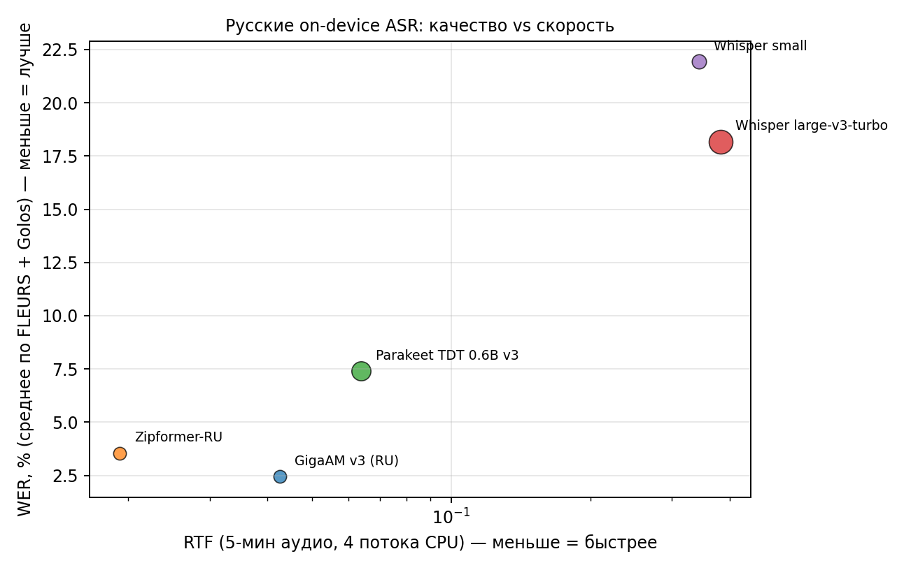

# Лидерборд локальных ASR-моделей для русского (Android / Kotlin)

Сравнение пяти моделей распознавания речи, которые можно запустить **на устройстве**
(без облака) и подключить в Kotlin-приложение. Качество — приоритет, скорость и
размер — вторичны. Все замеры воспроизводимы: код и сырые метрики лежат в
[`transcription_models/`](transcription_models/).

> **Коротко.** Для русского берите **GigaAM v3** (229 МБ): лучшее качество на обоих
> датасетах и один из самых быстрых вариантов. Если критичны размер и скорость —
> **Zipformer-RU** (73 МБ), он совсем немного уступает на чтении и отлично
> справляется с короткими командами. Whisper через sherpa-onnx для русского
> **не рекомендуется**: на 4% фраз уходит в циклы повторов, а на коротких командах
> WER 22–33%.

---

## 1. Итоговый лидерборд

Ранжирование — по среднему WER двух датасетов (чтение + спонтанные команды),
качество первично. RTF = время обработки / длительность аудио (меньше — быстрее),
замер на 10 сегментах по ~20 с.

| # | Модель | Размер | WER FLEURS (чтение) | WER Golos (команды) | **WER avg** | CER FLEURS | RTF | RAM | Медиана WER | Фраз с WER>80% |
|---|---|---|---|---|---|---|---|---|---|---|
| 1 | **GigaAM v3 (RU)** | 229 МБ | **3.77%** (2.81–4.87) | **1.10%** | **2.44%** | 1.29% | 0.043 | 337 МБ | 0.0% | 0% |
| 2 | **Zipformer-RU** | 73 МБ | 5.59% (4.44–6.85) | 1.50% | 3.55% | 1.65% | **0.019** | 401 МБ | 0.0% | 0% |
| 3 | **Parakeet TDT 0.6B v3** | 670 МБ | 7.69% (6.49–8.94) | 7.09% | 7.39% | 2.01% | 0.064 | 988 МБ | 5.3% | 0% |
| 4 | **Whisper large-v3-turbo** | 1037 МБ | 13.89% (10.29–17.87) | 22.48% | 18.18% | 9.34% | 0.382 | 2288 МБ | 4.8% | 4% |
| 5 | **Whisper small** | 375 МБ | 11.29% (9.83–12.85) | 32.57% | 21.93% | 2.76% | 0.343 | 1234 МБ | 9.3% | 0% |

В скобках — 95% bootstrap-интервал по фразам. «Медиана WER» — типичная фраза
(у GigaAM и Zipformer половина фраз распознана без единой ошибки).



**Как читать таблицу**

- **GigaAM v3** — лучший выбор: минимальный WER, 229 МБ, RTF 0.043 (~23× быстрее
  реального времени на десктопном CPU). Разрыв с остальными большой и стабильный.
- **Zipformer-RU** — в 3 раза меньше и в 2 раза быстрее, при этом всего +1.8 п.п. WER
  на чтении. На коротких командах практически не уступает GigaAM. Лучший вариант
  для слабых устройств и «мгновенной» диктовки.
- **Parakeet TDT 0.6B v3** — 25 европейских языков, пунктуация и регистр «из коробки»,
  но 670 МБ, ~1 ГБ RAM и заметно выше WER на русском. Брать, если нужен мультиязык
  в одном приложении.
- **Whisper large-v3-turbo** — по медиане хорош (4.8%), но 4% фраз уходят в циклы
  («а а а а…», повтор фразы), из-за чего средний WER разваливается. Плюс 1 ГБ весов
  и 2.3 ГБ RSS. Через sherpa-onnx — не вариант для продакшена на русском.
- **Whisper small** — без циклов, но качество на русском слабое, особенно на коротких
  командах (32.6%). Проигрывает GigaAM по всем осям, кроме «уже знаком».

---

## 2. Что и почему сравнивали

Критерии отбора:

1. **Русский язык** — обязательное требование.
2. **Полностью локальный инференс** (ONNX/CPU), без сети и API.
3. **Реальный путь в Kotlin/Android** — готовый рантайм или простая ONNX-обвязка.
4. **Лицензия**, допускающая коммерческое использование.

Все пять моделей запускаются одним рантаймом — **sherpa-onnx** (C++ + ONNX Runtime,
официальное Kotlin API `com.k2fsa.sherpa.onnx`). Это даёт честное сравнение «в
одинаковых условиях» и одинаково простую интеграцию.

| Модель | Источник | Лицензия | Языки | Особенности |
|---|---|---|---|---|
| GigaAM v3 (RNNT) | [salute-developers/GigaAM](https://github.com/salute-developers/GigaAM) | MIT | RU | обучена на русском, есть вариант с пунктуацией |
| Zipformer-RU | [alphacep/vosk-model-ru](https://huggingface.co/alphacep/vosk-model-ru) | Apache-2.0 | RU | лёгкая, из семейства Vosk/icefall |
| Parakeet TDT 0.6B v3 | [nvidia/parakeet-tdt-0.6b-v3](https://huggingface.co/nvidia/parakeet-tdt-0.6b-v3) | CC-BY-4.0 | 25 EU + RU | пунктуация/регистр, TDT-декодер |
| Whisper large-v3-turbo | [openai/whisper](https://github.com/openai/whisper) | MIT | 99 | 4 decoder-слоя вместо 32 |
| Whisper small | [openai/whisper](https://github.com/openai/whisper) | MIT | 99 | компромисс размер/качество |

---

## 3. Методика

**Датасеты**

| Датасет | Фраз | Длительность | Характер речи |
|---|---|---|---|
| FLEURS `ru_ru` test | 200 | 38.6 мин | чтение вслух, чистый звук, средняя фраза 11.6 с |
| Golos 10h crowd | 200 | 13.7 мин | спонтанные короткие команды, шум/телефон, средняя фраза 4.1 с |

**Метрики.** WER и CER через `jiwer`; 95% доверительный интервал — bootstrap по
фразам (2000 ресэмплов). Дополнительно: медиана WER по фразам и доля «катастроф»
(WER > 80%) — она показывает склонность к галлюцинациям/циклам.

**Нормализация текста** (применяется и к эталону, и к гипотезе): lower-case, `ё→е`,
удаление пунктуации и дефисов, числа → слова (`num2words`), схлопывание пробелов.
Так сравниваются модели с ITN и без, а пунктуация не влияет на WER.

**Железо и софт.** AMD Ryzen 5 5500 (6C/12T), 32 ГБ RAM, Windows 11; sherpa-onnx
1.13.8 (Python), int8-веса, `num_threads=4`, 16 кГц моно. Машина во время замеров
была частично загружена другими задачами, поэтому **абсолютные RTF завышены**;
сравнение моделей между собой корректно, но на телефоне цифры будут другими
(ориентировочно в 2–4 раза медленнее).

**Ограничения**

- В выборке FLEURS 88 уникальных предложений (датасет даёт несколько дикторов на
  фразу) — интервалы уже, чем при полностью независимых фразах.
- И GigaAM, и Zipformer-RU с высокой вероятностью видели Golos/OpenSTT в обучении,
  поэтому их WER на Golos оптимистичен. FLEURS в этом смысле чище.
- Whisper в sherpa-onnx обрабатывает только первые 30 с волны; для длинных записей
  нужна нарезка (VAD). Это учтено в замере скорости (сегменты по ~20 с).

---

## 4. Разбор моделей

### 4.1. GigaAM v3 (RNNT) — 229 МБ · WER 2.44%

Русскоязычная модель от Sber (GigaChat Team), MIT. В бенчмарке — вариант
`nemo-transducer-giga-am-v3` (RNNT, int8 encoder). Есть также CTC-вариант (чуть
быстрее) и **punct-вариант** с пунктуацией и регистром.

- **Плюсы:** лучшее качество на обоих доменах; половина фраз — 0 ошибок; 229 МБ;
  RTF 0.043; нет пунктуационных артефактов в WER.
- **Минусы:** только русский; нужен сегментированный вход (на 5-минутном файле
  одним куском падает с ошибкой broadcast — режьте VAD/30-секундными окнами);
  без punct-варианта текст без заглавных и знаков.
- **Когда брать:** основной движок приложения для русского.

```
sherpa-onnx-nemo-transducer-giga-am-v3-russian-2025-12-16
modelType = "nemo_transducer"
encoder.int8.onnx + decoder.onnx + joiner.onnx + tokens.txt
```

### 4.2. Zipformer-RU — 73 МБ · WER 3.55%

Лёгкая русская модель из экосистемы Vosk/icefall (Apache-2.0), сконвертирована в
sherpa-onnx. Трансдьюсер, int8.

- **Плюсы:** 73 МБ и RTF 0.019 (в 2 раза быстрее GigaAM); на Golos почти не уступает
  лидеру; половина фраз без ошибок; отлично для диктовки и команд.
- **Минусы:** на чтении +1.8 п.п. WER к GigaAM; нет пунктуации; только русский.
- **Когда брать:** бюджетные устройства, быстрый старт, сценарии «короткая команда →
  мгновенный текст», fallback, если GigaAM не влезает.

```
sherpa-onnx-zipformer-ru-int8-2025-04-20
modelType = "transducer"
encoder.int8.onnx + decoder.onnx + joiner.int8.onnx + tokens.txt
```

### 4.3. Parakeet TDT 0.6B v3 — 670 МБ · WER 7.39%

NVIDIA NeMo, 0.6B параметров, 25 европейских языков включая русский, пунктуация и
регистр на выходе. TDT-декодер (быстрее обычного RNNT).

- **Плюсы:** один файл на 25 языков; готовые пунктуация/капитализация; стабилен,
  без циклов; на FLEURS CER всего 2.0%.
- **Минусы:** 670 МБ и ~1 ГБ RAM; на русском заметно слабее GigaAM (7.7% против 3.8%);
  на коротких командах 7.1%.
- **Когда брать:** мультиязычное приложение (RU + EU), важна пунктуация, устройство
  с 8+ ГБ RAM.

```
sherpa-onnx-nemo-parakeet-tdt-0.6b-v3-int8
modelType = "nemo_transducer"
encoder.int8.onnx + decoder.int8.onnx + joiner.int8.onnx + tokens.txt
```

### 4.4. Whisper large-v3-turbo — 1037 МБ · WER 18.18%

OpenAI, 809M параметров, 4 decoder-слоя. В sherpa-onnx — int8 encoder/decoder.

- **Плюсы:** 99 языков; на «нормальных» фразах медиана 4.8%, местами идеален;
  пунктуация и регистр; MIT.
- **Минусы:** **4% фраз уходят в циклы повторов** (greedy-декодер sherpa-onnx не
  делает temperature fallback, repetition penalty и не поддерживает beam search —
  проверено, `tail_paddings` не помогает); 1 ГБ весов, 2.3 ГБ RSS; только первые
  30 с за вызов; RTF 0.38 (на телефоне, вероятно, медленнее реального времени).
- **Когда брать:** если нужен именно Whisper — брать **whisper.cpp** (там есть
  fallback и подавление тишины), а не sherpa-onnx. И обязательно VAD.

### 4.5. Whisper small — 375 МБ · WER 21.93%

- **Плюсы:** без циклов; 99 языков; 375 МБ; пунктуация.
- **Минусы:** слабое русское качество (11.3% на чтении, 32.6% на командах); проигрывает
  GigaAM по качеству, размеру и скорости одновременно.
- **Когда брать:** практически никогда для русского; разве что как «уже есть» в проекте.

---

## 5. Примеры транскрибирования

Сырой вывод моделей (пунктуация/регистр — как выдала модель; при подсчёте WER текст
нормализуется). Полный набор — в
[`transcription_models/results/examples.md`](transcription_models/results/examples.md).

### 5.1. FLEURS, короткая чистая фраза

**Эталон:** Аналогично, мужчины должны носить брюки, которые бы закрывали колени.

- **GigaAM v3:** аналогично мужчины должны носить брюки которые бы закрывали колени *(0%)*
- **Parakeet v3:** аналогично мужчины должны носить брю которые бы закрывали колени *(11%)*
- **Whisper turbo:** аналогично мужчины должны носить брюки которые бы закрывали колени *(0%)*
- **Whisper small:** аналогично мужчины должны носить брюки которые бы закрывали колени *(0%)*
- **Zipformer-RU:** аналогично мужчины должны носить брюки которые бы закрывали колени *(0%)*

### 5.2. FLEURS, длинная фраза — циклы Whisper

**Эталон:** NextGen — это система, которая, по заверению Федеральной авиационной
администрации США, позволит самолетам летать по сокращенным маршрутам и ежегодно
экономить миллионы галлонов топлива, а также снизить выбросы углерода.

- **GigaAM v3:** некстжан это система которая по заверению федеральной авиационной
  администрации сша позволит самолетам летать по сокращенным маршрутам и ежегодно
  экономить миллионы галлонов топлива а также снизить выбросы углерода *(4%)*
- **Parakeet v3:** nextgen это система … снизить выбросы углерода *(0%)*
- **Whisper turbo:** nextgen это система которая по заверению федеральной авиации
  **а а а а а а а а а а а а а а а а а а а а а а а а а а а а а а а а** *(185%)*
- **Whisper small:** next gen это система … миллионы голонов топлива … *(11%)*
- **Zipformer-RU:** некс джен это система … *(7%)*

### 5.3. Golos, типичная команда

**Эталон:** салют как отключить автоплатеж с карты сбербанка на мобильный телефон

- **GigaAM v3:** салют как отключить автоплатеж с карты сбербанка на мобильный телефон *(0%)*
- **Zipformer-RU:** то же самое *(0%)*
- **Parakeet v3:** Салют, как отключить автоплатеж с карты Сбербанка на мобильный телефон? *(0%)*
- **Whisper turbo:** Салют. Как **включить** автоплатеж с карты Сбербанка на мобильный телефон *(10%)*
- **Whisper small:** Как и включить автоплотёж с карты с бербанка на мобильный телефон? *(60%)*

### 5.4. Golos, короткая фраза — цикл Whisper и ошибка падежа

**Эталон:** алексее николаевиче

- **GigaAM v3:** алексее николаевиче *(0%)*
- **Zipformer-RU:** алексее николаевиче *(0%)*
- **Parakeet v3:** Алексее Николаевиче. *(0%)*
- **Whisper turbo:** Алексей Николаевич. Алексей Николаевич. Алексей Николаевич. … *(500%)*
- **Whisper small:** Алексея Николаевича *(100%)*

**Эталон:** мама

- **GigaAM v3:** мамы *(100%)*
- **Zipformer-RU:** мамы *(100%)*
- **Parakeet v3:** Mama. *(100%)*
- **Whisper turbo:** Мама. *(0%)*
- **Whisper small:** Мама. *(0%)*

Последний пример показывает слабое место русских моделей без языкового контекста:
на одном слове они путают падеж. Для команд это лечится словарём/hotwords, для
свободной речи — не критично.

---

## 6. Как подключить в Kotlin

Подробная инструкция и готовая обёртка —
[`transcription_models/kotlin/`](transcription_models/kotlin/).

```kotlin
val asr = SherpaTranscriber(
    context = applicationContext,
    modelDir = File(filesDir, "models/gigaam-v3").absolutePath,
    numThreads = 4,
    modelType = "nemo_transducer",
)
val text = asr.transcribe(samples16k)   // FloatArray, 16 кГц, моно, [-1, 1]
```

Что нужно:

1. Runtime sherpa-onnx (~7 МБ на ABI): `libonnxruntime.so` + `libsherpa-onnx-jni.so`
   в `jniLibs/arm64-v8a/`, Kotlin-исходники `com.k2fsa.sherpa.onnx` в проект.
2. Файлы модели (см. таблицу выше) — лучше скачивать при первом запуске в
   `filesDir`, а не класть в APK (лимит Play Store, распаковка).
3. 16 кГц моно на входе. Пишите сразу в 16 кГц через `AudioRecord` или ресемплите.
4. VAD (silero) для длинных записей: режьте на сегменты ≤ 20–30 с.

---

## 7. Что осталось за бортом

| Кандидат | Почему не в лидерборде |
|---|---|
| **T-one** (T-Bank) | Хороший русский стриминговый ASR, но нет официального Android/Kotlin-пакета: нужен собственный chunked-инференс, state management и обвязка в `onnxruntime-android`. Для live-режима — да, для «транскрибации файла» — лишняя работа. Если понадобится стриминг, сравните с Zipformer streaming из sherpa-onnx. |
| **Vosk small-ru** | Самый простой AAR, но модель устарела (по качеству — уровень ниже Zipformer-RU при сопоставимом размере). |
| **SenseVoice-Small** | Отличное качество/скорость, но только zh/en/ja/ko/yue — русского нет. |
| **Moonshine (base/tiny)** | Английский (и несколько языков v2), русского нет. |
| **Whisper large-v3 (full)** | turbo даёт почти то же качество при меньшем времени; full — 3 ГБ, на телефоне нецелесообразно. |
| **GigaAM v3 CTC / v3-punct** | Не включены, чтобы не дублировать GigaAM: CTC чуть быстрее/слабее, punct — тот же WER плюс пунктуация. Для продакшена берите **punct**-вариант. |
| **sherpa-ncnn** | Runtime легче (~1.6 МБ), но поддерживает только zipformer-модели; GigaAM/Parakeet/Whisper — нет. |

---

## 8. Рекомендация

1. **База:** GigaAM v3 (punct-вариант для пунктуации) — лучшее качество, 229 МБ,
   ~23× realtime на десктопе.
2. **Лёгкий режим / слабые устройства:** Zipformer-RU, 73 МБ, RTF 0.019.
3. **Мультиязык:** Parakeet TDT 0.6B v3 (25 языков, пунктуация), если готовы к
   670 МБ и ~1 ГБ RAM.
4. **Стриминг:** отдельная история — Zipformer streaming (sherpa-onnx) или T-one
   с собственной обвязкой; офлайн-модели из этого лидерборда для live-режима
   не предназначены.
5. **Whisper** для русского через sherpa-onnx не берите. Если очень нужен —
   whisper.cpp + VAD + ограничение сегмента 30 с.

---

## 9. Воспроизведение

```bash
pip install sherpa-onnx jiwer soundfile numpy num2words pyarrow psutil matplotlib
python transcription_models/scripts/download.py
python transcription_models/scripts/download_parakeet.py
python transcription_models/scripts/eval.py
python transcription_models/scripts/eval_golos.py
python transcription_models/scripts/speed.py
python transcription_models/scripts/make_report.py
```

Сырые метрики: [`transcription_models/results/leaderboard.csv`](transcription_models/results/leaderboard.csv),
`results.json`, `golos.json`, `speed.json`, `examples.md`.
